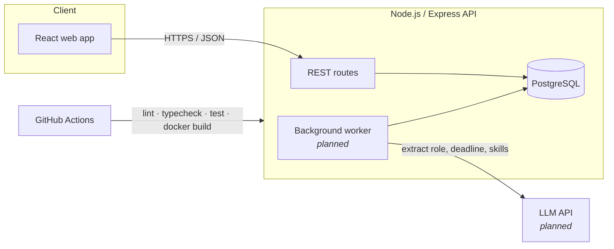

# Job Application Tracker

Track internship applications, import job postings with LLM-based extraction, and see how well each resume version matches a posting's required skills.

> **Status:** Week 1: API skeleton, database schema, CI. Live demo: _link after first deploy_

## Architecture



- **API**: TypeScript, Express 5, `pg` (raw SQL, no ORM), Zod for validation, Pino for structured JSON logs.
- **Database**: PostgreSQL 17. Schema changes are plain SQL migrations in `apps/api/migrations/`, applied by a small runner (`src/db/migrate.ts`).
- **Tests**: Vitest + Supertest against a real Postgres, both locally and in CI.
- **CI**: GitHub Actions on every push and PR (see `.github/workflows/ci.yml`).

## Running locally

Requirements: Node 24 (`nvm use`), Docker.

```bash
npm install
docker compose up -d db          # Postgres on :5432 (also creates jobtracker_test)
cp .env.example apps/api/.env
npm run migrate
npm run dev                      # http://localhost:3000/health/ready
npm test                         # wipes and re-migrates jobtracker_test
```

Or run everything in containers: `docker compose up --build`.

## Repository layout

```
apps/
  api/
    migrations/        SQL migrations, applied in filename order
    src/
      app.ts           builds the Express app (imported by tests)
      server.ts        starts the HTTP server, graceful shutdown
      config.ts        env var validation (fails fast on startup)
      db/              connection pool + migration runner
      routes/          route modules
    test/              integration tests against real Postgres
  web/                 React app (Week 2)
docs/
  BUILD_LOG.md         what broke and how it was fixed
  DECISIONS.md         why the main choices were made
.github/workflows/     CI
```

## Data model

`users` 1─* `resume_versions` 1─* `applications` (and `users` 1─* `applications`). A composite foreign key ensures an application can only reference a resume owned by the same user. See [`001_init.sql`](apps/api/migrations/001_init.sql).

## Roadmap

- [x] Week 1: API skeleton, schema, Docker Compose, CI
- [ ] First deploy (hello version)
- [ ] Auth, CRUD for applications, React UI
- [ ] Posting import: background job, LLM extraction, schema validation, retries
- [ ] Extraction accuracy evaluation on ~30 hand-labelled postings
- [ ] Playwright E2E tests in CI
- [ ] Deadline reminders
